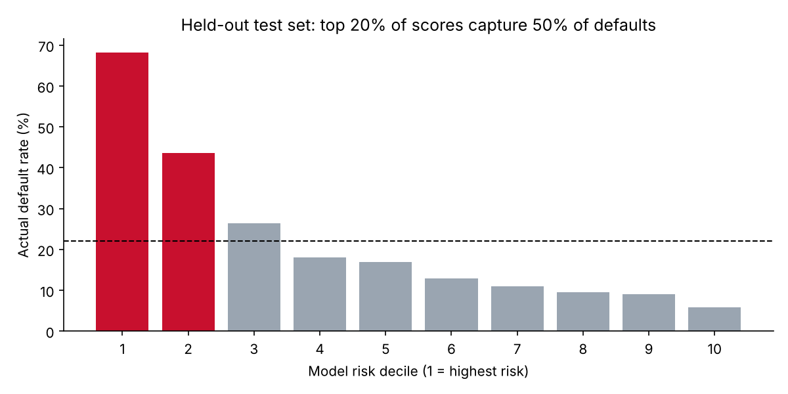

# Credit Card Default Risk Analysis

Which credit-card clients are most likely to miss next month's payment, and what should a card issuer do about it?

This project builds a **SQL (DuckDB) pipeline with data-quality checks**, an **interpretable logistic regression model**, and a **plain-English risk memo** for credit and collections teams. It uses 30,000 clients from the public UCI "Default of Credit Card Clients" dataset.

➡️ **Read the findings:** [`reports/risk_memo.md`](reports/risk_memo.md)

## Headline results

- Clients **2+ months late** in September defaulted at **70%** next month (against 22% overall). They are 10% of clients but 33% of all defaults.
- The model reaches **AUC 0.77** on 9,000 held-out clients (Gini 0.53, KS 0.42). The riskiest 10% default at **68%** and the safest 10% at **6%**.
- The **top 20%** of risk scores capture **50%** of defaults, which supports a tiered collections strategy.
- **No demographics are used in the model.** Sex, age, education and marital status are left out as protected or sensitive attributes in credit decisions.



## How it works

```
data/raw/default_of_credit_card_clients.csv
        │
sql/01_staging.sql        rename to readable month-based columns, map undocumented codes
sql/02_data_quality.sql   8 blocking checks (row count, unique IDs, nulls, ranges, binary target)
                          + 4 warning checks (undocumented codes, negative bills, over-limit balances)
sql/03_features.sql       behavioural features + 4 segment marts (status, utilisation, limit, late months)
        │
src/pipeline.py           runs the SQL, stops if any blocking check fails, exports CSVs
src/model.py              logistic regression, 70/30 stratified split, AUC/Gini/KS, risk deciles,
                          odds ratios with 95% CIs, comparison to a simple "2+ months late" rule
reports/risk_memo.md      findings, risk-tier actions, caveats
tests/                    15 pytest tests (data quality, feature logic, mart reconciliation, model checks)
```

## Run it

```bash
pip install -r requirements.txt
python src/pipeline.py      # build DuckDB database + data-quality report
python src/model.py         # train model, write metrics, charts and odds ratios
pytest -q                   # 15 tests
```

Outputs land in `outputs/` (metrics.json, odds_ratios.csv, test_deciles.csv, dq_results.csv, segment marts) and `reports/figures/`.

## Data

Yeh, I. (2009). *Default of Credit Card Clients* [Dataset]. UCI Machine Learning Repository. https://doi.org/10.24432/C55S3H (licensed CC BY 4.0).
These are 30,000 clients of a Taiwanese card issuer, Apr–Sep 2005. The target is default in October 2005, and amounts are in NT$.

## Limitations

- The data comes from a single issuer in 2005, during a period of high card defaults. Patterns transfer better than absolute rates.
- Some repayment-status codes behave unexpectedly (for example, "paid in full" clients default slightly more than revolving clients), so each status is modelled as its own indicator.
- Odds ratios show associations, not causes, and the repayment-history features are correlated with each other.

## Tools

SQL (DuckDB) · Python (pandas, scikit-learn, statsmodels, matplotlib) · pytest
