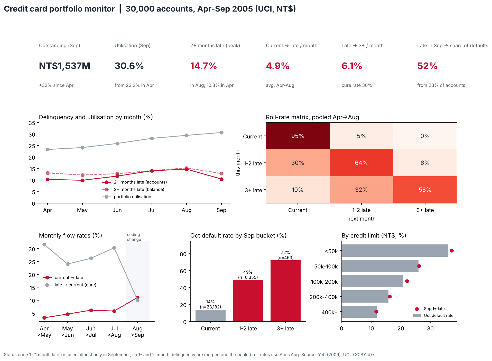

# Portfolio Monitoring Memo: How Is Delinquency Moving?

**Data:** the same 30,000 credit-card accounts (UCI, Apr–Sep 2005), reshaped into 180,000 account-months.
**Question:** The [risk memo](risk_memo.md) asks *who* will default. This memo asks what a retail-credit team would review each month: how balances, delinquency and roll rates are trending, and where early intervention pays off.

## Key findings

1. **The book grew fast and got riskier.** Outstanding balances rose **32%** from April to September (NT$1,168M to NT$1,537M), and portfolio utilisation climbed from **23.2%** to **30.6%**. Over the same months the share of accounts 2+ months late rose from **10.3%** to a peak of **14.7%** in August.
2. **Most current accounts stay current, but the inflow is rising.** On average **4.9%** of current accounts fell behind each month (Apr→Aug). That flow nearly doubled, from **3.2%** (Apr→May) to **5.8%** (Jul→Aug).
3. **Early delinquency is sticky.** Of accounts 1–2 months late, only **30%** cured the next month, **64%** stayed 1–2 months late and **6%** rolled to 3+ months. Once an account reaches 3+ months, just **10%** return to current.
4. **Delinquent accounts drive most losses.** Accounts late in September were **23%** of the book but **52%** of October defaults. Their default rates were **49%** (1–2 months late) and **72%** (3+ months), against **14%** for current accounts.
5. **Small limits carry the most delinquency.** In September, **37%** of accounts with limits under NT$50k were late, against **12%** for limits of NT$400k and above. Their October default rates follow the same gradient (36% vs 12%).

## What I would recommend to the team

- **Track the current→late flow as the lead indicator.** It almost doubled (3.2% to 6.1% by Jun→Jul) before the August delinquency peak, so it gives earlier warning than the delinquency rate itself.
- **Focus collections on the first late month.** With a 30% cure rate and a 49% next-month default rate for 1–2 months late, this bucket is where contact has the most room to change outcomes.
- **Review limit growth on small-limit accounts.** They combine the highest delinquency with rising utilisation.

## Data quality and method

- **Coding change in September.** Status code 1 ("1 month late") appears for 3,688 accounts in September but only 34 accounts across April–August. The issuer seems to have recorded early delinquency differently before September. To keep months comparable I:
  - merged 1- and 2-month delinquency into one "1–2 months late" bucket,
  - used **2+ months late** as the trend metric (September's 1+ rate of 22.7% is not comparable with earlier months),
  - pooled the roll-rate matrix over Apr→Aug only, and flagged Aug→Sep separately (its cure rate drops to 10%, which is likely an artefact).
- **Blocking checks** (pipeline stops on failure): every account has 6 months, there are exactly 5 transitions per account, and every row of the roll-rate matrix sums to 100%. A warning check counts the status-1 quirk.
- **Balances** are statement amounts. Credit balances (negative bills) count as zero outstanding.
- **Caveat:** this is one issuer in 2005, during a period of high card defaults. The flows and gradients transfer better than the absolute levels.

## Files

- `sql/04_portfolio.sql`: account-month panel, KPI and roll-rate marts, portfolio checks
- `src/portfolio.py`: runs the layer, exports `outputs/portfolio/*.csv` (ready to load into Power BI or Tableau), draws the dashboard
- `tests/test_portfolio.py`: 9 tests (panel shape, reconciliation to source, roll-rate integrity, quirk count)
