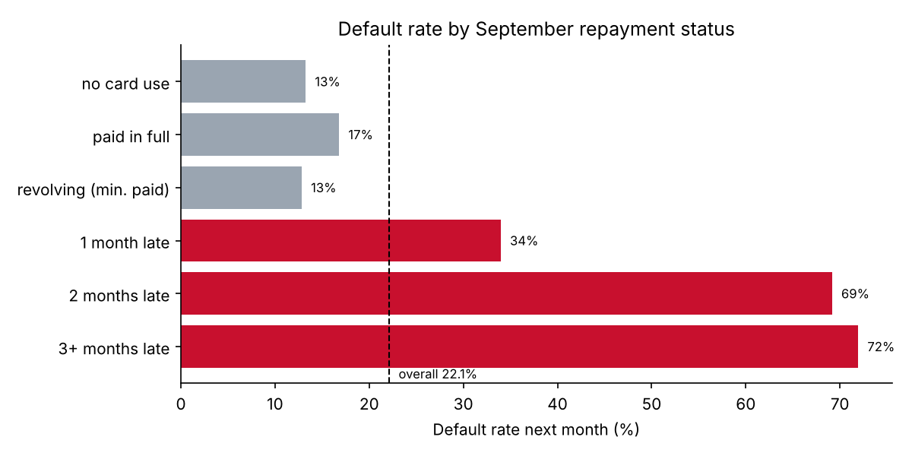
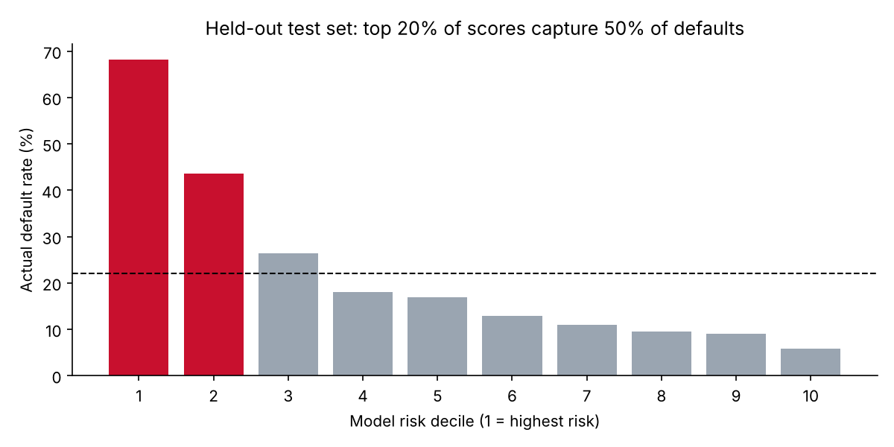

# Risk Memo: Who Is Likely to Default Next Month?

**Data:** 30,000 credit-card clients of a Taiwanese issuer, Apr–Sep 2005 (UCI "Default of Credit Card Clients").
**Question:** Using information the issuer already holds at the end of September, which clients are most likely to miss their October payment, and what should credit and collections teams do about it?

## Key findings

1. **Recent lateness is the strongest warning sign.** Clients who were 2 or more months late in September defaulted at **70%** the following month, against **22%** overall. They make up only 10% of clients but **33% of all defaults**.
2. **Repeated lateness compounds risk.** Default rates rise steadily with the number of late months in the last six: **12%** for clients never late, **30%** for one late month, and **64%** for four to six late months.
3. **Smaller credit limits carry more risk.** Clients with limits under NT$50k defaulted at **36%**, three times the **12%** rate for limits of NT$400k and above. This likely reflects the issuer's own earlier risk judgement when setting limits.
4. **High balances matter less once repayment history is known.** Utilisation looks risky on its own (30% default rate for clients over their limit against 19% under 10% utilisation). But after controlling for repayment history, its effect in the model is small and not statistically significant.

## Model

- **Approach:** logistic regression on 11 behavioural features (repayment status, months late, credit limit, utilisation, payment amounts). It was trained on 70% of clients and evaluated on a held-out 30% (9,000 clients).
- **Performance on held-out clients:** AUC **0.77** (Gini 0.53, KS 0.42). Training AUC is 0.78, so the model is not overfitting.
- **Ranking power:** the riskiest 10% of clients default at **68%** and the safest 10% at **6%**. The top 20% of scores capture **50%** of all defaults.
- **Demographics are excluded on purpose.** Sex, age, education and marital status are not used in the model, because they are protected or sensitive attributes in credit decisions. Behavioural data alone gives strong separation.

**An honest comparison:** a simple rule, "flag anyone 2+ months late", already matches the model's top decile, with a 69% hit rate and 32% of defaults caught. The model's real value is in ranking the remaining 90% of clients. A rule cannot tell a 25% risk from a 6% risk; the model can.

## Recommendations

| Risk tier (model score) | Share of clients | Default rate (test) | Suggested action |
|---|---|---|---|
| **Very high** (decile 1) | 10% | 68% | Early collections contact before the due date; freeze limit increases |
| **High** (decile 2) | 10% | 44% | Payment reminders by SMS or app; offer instalment plans before the client falls behind |
| **Medium** (deciles 3–5) | 30% | 17–26% | Monitor monthly; no limit increases without review |
| **Low** (deciles 6–10) | 50% | 6–13% | Business as usual; candidates for limit-increase or cross-sell offers |

- **Prioritise collections effort by score.** Contacting the top 20% reaches half of all likely defaulters while calling only one in five clients.
- **Act at the first late month.** Default risk roughly doubles to triples between clients who are not late (13–17%) and those 1 month late (34%), then doubles again at 2 months late (69%). The first missed payment is the cheapest point to intervene.
- **Review limits on small-limit accounts** with any recent lateness, since they combine the two strongest risk signals.

## Caveats

- **Old data from one country.** The data is from Taiwan in 2005, during a period of high card defaults, so absolute default rates are far above today's levels. The *patterns* (lateness and limit as drivers) are what transfer, not the exact rates.
- **Undocumented codes.** "Paid in full" clients default slightly more often (17%) than revolving clients (13%). This is a known quirk of how repayment codes are recorded in this dataset, so the model treats each status separately rather than assuming an order.
- **Data quirks.** 468 education and 377 marital-status codes are undocumented, and are grouped as "other" and used for description only. 1,930 clients have a negative bill in at least one month (overpayment credits).
- **Associations, not causes.** The odds ratios show association, not causation. Repayment-history features are correlated with each other, so individual coefficients should not be over-read.
